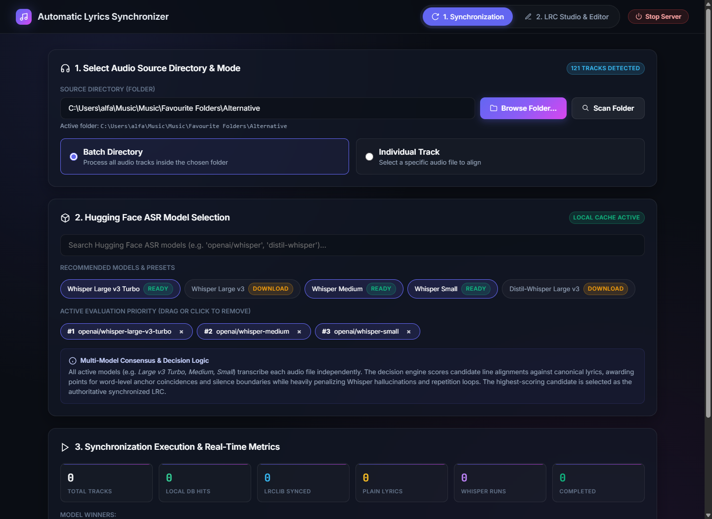
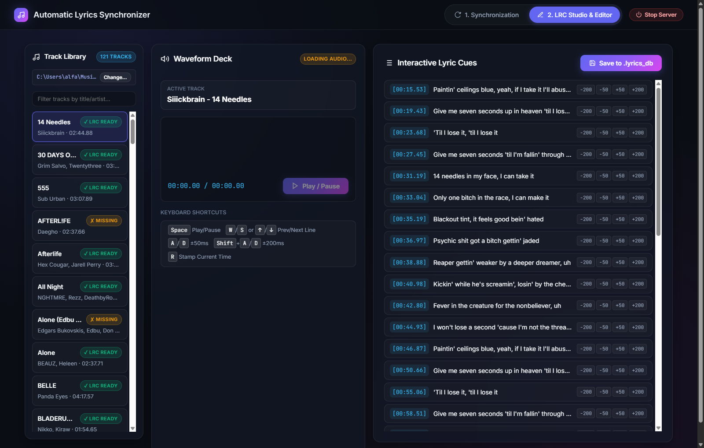

# Automatic Lyrics Synchronizer (Studio v2.0)

A high-performance Python 3.13 system and Web Studio designed to retrieve, transcribe, anchor-interpolate, and micro-edit synchronized `.lrc` lyrics for local audio libraries (FLAC, MP3, WAV, M4A, OGG).

Combines native REST retrieval from LRCLIB, Genius API fallback, multi-model ASR evaluation (OpenAI Whisper, Distil-Whisper, and Alibaba Qwen3-ASR with Qwen3-ForcedAligner), and an interactive dual-track waveform micro-editor.

---

## Web Studio Previews

### 1. Synchronization & Model Discovery (`/sync`)
Interactive setup with native folder picker, Hugging Face model search and local cache readiness badges, active evaluation priority management, and live SSE event streaming with real-time metrics.



### 2. 3-Panel LRC Studio & Micro-Editor (`/editor`)
3-column workspace featuring instant track preloading, `[✓ LRC READY]` vs `[✗ MISSING]` status badges, Wavesurfer.js audio visualizer, offset adjusting pills ($\pm 50\text{ms}$ / $\pm 200\text{ms}$), keyboard shortcuts, and direct saving to `.lyrics_db/` and local music directories.



---

## Features

- **Two-Page Web Studio**:
  - **`/sync`**: Audio source directory scanning, Hugging Face model search with autocomplete and local cache readiness badges (`[READY]` / `[DOWNLOAD]`), active model ordering, `Force ASR` multi-model evaluation bypass, and live SSE execution log.
  - **`/editor`**: Responsive dual-track micro-editor with Wavesurfer.js, active cue auto-scrolling, timestamp nudging, live audio scrubbing, and instant sync commit.
- **Graceful Lifecycle Management**:
  - Integrated `⏻ Stop Server` button in the top navigation header to terminate the local Python backend cleanly via `POST /api/shutdown`.
- **Intelligent Waterfall Resolver**:
  1. **Canonical Local Cache (`.lyrics_db/`)**: Instant hash/metadata restoration for previously synchronized tracks.
  2. **Authoritative Local Override**: Moves `.lrc` files placed next to audio directly into canonical storage.
  3. **LRCLIB Native REST API**: Native client integration with zero desktop binary dependencies (`https://lrclib.net/api`).
  4. **Genius API Client**: Authenticated fallback for plain-text lyrics when public LRC databases miss.
  5. **Multi-Model ASR Consensus**: Evaluates candidates across multiple local or downloaded Whisper/Qwen models, scoring anchor lines and silence boundaries to choose the highest-confidence synchronization.
- **Qwen3-ASR & ForcedAligner Integration**:
  - Native integration of Alibaba's `Qwen3ASRModel` paired with `Qwen/Qwen3-ForcedAligner-0.6B` and `max_new_tokens=512` for precise phoneme/word timestamp alignment.
- **Decoupled Architecture**:
  - Clean separation between core synchronization engine (`modules/`) and interfaces (CLI `main.py` and FastAPI `server/`).

---

## Quick Start

### Prerequisites
- **Python 3.13** (or 3.10+)
- **CUDA-enabled PyTorch** (recommended for local GPU ASR inference)
- **Windows / Linux / macOS**

### 1. Installation
```powershell
git clone https://github.com/your-username/Automatic-Lyrics-Synchronizer.git
cd Automatic-Lyrics-Synchronizer

# Install dependencies
pip install -r requirements.txt
```

*(Optional) Install GPU-accelerated PyTorch:*
```powershell
pip install --index-url https://download.pytorch.org/whl/cu121 torch torchvision
```

### 2. Launching the Web Studio
```powershell
python -m uvicorn server.main:app --host 127.0.0.1 --port 8585 --reload
```
Open your browser at **[http://127.0.0.1:8585](http://127.0.0.1:8585)**.

### 3. CLI Batch Mode
To run batch synchronization directly via terminal:
```powershell
python main.py
```

---

## Keyboard Shortcuts (LRC Studio)

| Key Shortcut | Action |
|---|---|
| <kbd>Space</kbd> | Play / Pause audio playback |
| <kbd>W</kbd> / <kbd>S</kbd> or <kbd>↑</kbd> / <kbd>↓</kbd> | Navigate previous / next lyric line |
| <kbd>A</kbd> / <kbd>D</kbd> | Adjust active timestamp by $\pm 50\text{ms}$ |
| <kbd>Shift</kbd> + <kbd>A</kbd> / <kbd>D</kbd> | Adjust active timestamp by $\pm 200\text{ms}$ |
| <kbd>R</kbd> | Stamp current playback position to active line |
| <kbd>Ctrl</kbd> + <kbd>S</kbd> | Save modified LRC to storage |

---

## Project Structure

```text
Automatic-Lyrics-Synchronizer/
├── docs/
│   └── screenshots/              # Web Studio UI visual assets
│       ├── sync_studio.png
│       └── lrc_editor.png
├── modules/
│   ├── lrclib_client.py          # Native LRCLIB REST client
│   ├── model_manager.py          # Hugging Face model search & cache manager
│   ├── pipeline.py               # Core LyricsSyncService orchestrator
│   ├── utils.py                  # Audio metadata extractor & LRC serializers
│   └── whisper_transcription.py  # Multi-model ASR router (Whisper & Qwen)
├── server/
│   ├── folder_picker.py          # Native Explorer dialog subprocess
│   ├── main.py                   # FastAPI application & shutdown handler
│   ├── routers/                  # Modular API routers (songs, models, sync, lyrics)
│   └── schemas.py                # Pydantic V2 request & response schemas
├── web/
│   ├── index.html                # Page 1: Sync, models & live telemetry
│   ├── editor.html               # Page 2: 3-Panel LRC Studio & micro-editor
│   └── style.css                 # Glassmorphic Google Antigravity stylesheet
├── config.py                     # Global configuration & default model candidates
├── main.py                       # CLI execution entrypoint
└── requirements.txt              # Production dependency manifest
```

---

## License & Credits
Licensed under the MIT License. Developed with FastAPI, Wavesurfer.js, Transformers, and Qwen ASR.
